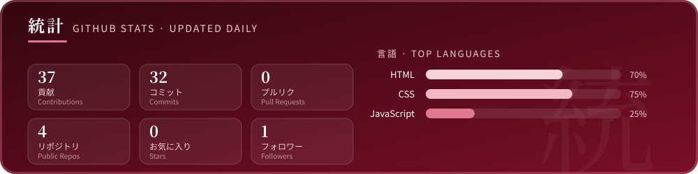
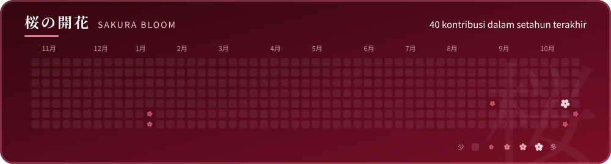

  

## Hai, aku Nadia 🌸

> *diam bukan berarti lemah, tapi LAPAR* 🍙

 

### プロフィール · Tentang Saya

| | |
|---|---|
| 🌸 **Nama** | Nadia Refnita Putri Batuallo |
| 🎓 **Status** | Mahasiswa Teknik Informatika |
| 🔭 **Lagi dipelajari** | Web dasar (HTML, CSS, JavaScript) & C++ |
| 🌱 **Tujuan** | Jadi Frontend Developer & Website Development|

 

### 技術 · Tech Stack

  
  
  
  
  
  
  

 

### 作品 · Proyek

| Repo | Isi |
|---|---|
| [**CodingCamp-12jan2026-NadiaRefnitaPutriBatuallo**](https://github.com/nerlynmarioline-byte/CodingCamp-12jan2026-NadiaRefnitaPutriBatuallo) | Mini project coding camp software engineer (RevoU) · `HTML` |
| [**Web-dasar**](https://github.com/nerlynmarioline-byte/Web-dasar) | Latihan dasar membuat halaman web · `HTML` |
| [**Tugas-Push-Github**](https://github.com/nerlynmarioline-byte/Tugas-Push-Github) | Tugas belajar push ke GitHub · `CSS` |

 

### 統計 · GitHub Stats

 

### 桜の開花 · Sakura Bloom

Setiap kotak kontribusi jadi bunga sakura — makin sering commit, makin besar mekarnya. Diperbarui otomatis tiap hari.

 

